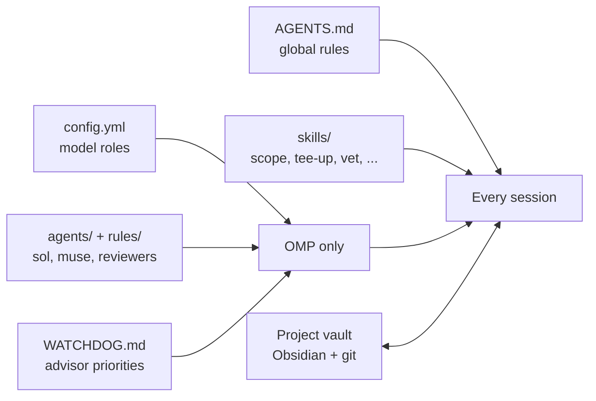

# How the setup works, and why

This page explains the setup that the files in this repo come from: the skills, the global instructions, the OMP agents and rules, and the project vault. It says what each part does and why it is there. For the install steps, read [omp-setup.md](omp-setup.md). For the story behind the setup, with a worked review of a real PR, read the blog post [Claude writes, Sol reviews: the skills I chain together for AI coding](https://blakemccarn.dev/blog/claude-writes-sol-reviews-ai-coding-skills).

The setup runs three coding agents side by side: Claude Code, Codex and [OMP (oh-my-pi)](https://github.com/can1357/oh-my-pi). The same skills and the same global instructions load in all three. OMP gets the most configuration, because it lets you give each model a role, define custom agents and add an advisor that reviews every turn.

## The parts

| Part | In this repo | Loads in |
|---|---|---|
| Global instructions | `extras/AGENTS.md` | Claude Code, Codex and OMP |
| Skills | `skills/` | Claude Code, Codex and OMP |
| The ponytail plugin | Not vendored. Install it from [DietrichGebert/ponytail](https://github.com/DietrichGebert/ponytail). | Claude Code, Codex and OMP |
| OMP settings | `extras/omp/config.yml` | OMP |
| OMP agents | `extras/omp/agents/` | OMP |
| OMP rules and commands | `extras/omp/rules/`, `extras/omp/commands/` | OMP |
| Advisor priorities and session titles | `extras/omp/WATCHDOG.md`, `extras/omp/TITLE_SYSTEM.md` | OMP |
| Language server and MCP settings | `extras/omp/lsp.json`, `extras/omp/mcp.json` | OMP |
| Project vault template | `skills/vault-workspace-setup/template/` | Any agent, through the `project-vault` skill |

## Claude writes, Sol reviews

One rule shapes the whole setup. Claude (Opus 5.5) writes the code. GPT 6.1 Sol reviews it and never edits files.

The rule comes from experience with these models, not from a benchmark. GPT models tend to overengineer, and Opus is the more trusted implementer. Sol is strong at review and at catching gaps. A reviewer from a different model family and provider finds more than a second model from the same provider, because the two models do not share the same blind spots. A different family can still miss the same bug, so tests and reading the code still matter.

The rule works the other way in Codex. When Sol writes a change in Codex, Opus reviews it.

The OMP settings make the rule concrete:

- Every role that can edit files (`default`, `slow`, `plan`, `task`) resolves to a Claude model.
- Sol holds the `advisor` and `review` roles, and the `sol` agent.
- An editing role falls back only to another Claude model. A provider outage moves Opus to Sonnet. The reviewer never becomes the author.
- The Sol and Muse models have empty fallback chains. A reviewer that cannot run is reported as missing, not replaced by Claude.

[omp-setup.md](omp-setup.md) explains each setting.

## Skills that chain other skills

Most of the process came from other people's skills. This repo keeps local copies, so local changes survive when the upstream versions move:

- `council`, `sol-loop` and `babysit-pr` come from [t3dotgg/tstack](https://github.com/t3dotgg/tstack).
- `unslop`, `technical-writing` and `blast-radius` come from [cursor/plugins](https://github.com/cursor/plugins).
- `grilling`, `to-spec` and `to-tickets` come from [mattpocock/skills](https://github.com/mattpocock/skills).
- `ponytail-review` comes from the [ponytail plugin](https://github.com/DietrichGebert/ponytail), installed rather than copied.

Three skills written for this repo, `scope`, `tee-up` and `vet`, chain those building blocks in a fixed order. Each one also decides what the agent may do at each step and where it must stop. That second job matters most. A skill that writes a plan must not quietly turn into a skill that deploys the plan.

### `scope` stops at approved tickets

1. The agent finds the project's tracker. It uses the tracker that the repo names, then a project vault, then GitHub Issues. If none fits, it asks you.
2. `grilling` questions you until you agree on the plan. The agent reads the code first, so it asks about decisions, not about facts it could look up.
3. `to-spec` turns the decisions into a draft spec with testable acceptance criteria and open questions.
4. A model from another family reviews the draft once, read-only. It flags dropped decisions, criteria nobody can test, gaps and scope you did not ask for. The agent fixes wording and scope problems itself and brings real decisions back to you.
5. `to-tickets` cuts the work into tickets that can each be built and proven alone.
6. You approve the spec and the tickets together. The agent publishes them, reads each one back, and stops. Nothing is built.

### `tee-up` stops at an open, green, unmerged PR

1. The ticket is the intent. The agent works from the ticket, not from its own summary of the ticket.
2. For a bug, the agent watches the bug fail before it edits anything. For a feature, it writes a test for an acceptance criterion and watches that test fail. If it cannot reproduce the problem, it stops and shows you the evidence.
3. The agent fixes the problem in its own git worktree. A focused test must fail without the change and pass with it. The agent runs the same checks that CI runs.
4. `sol-loop` reviews the change in rounds.
5. After the loop ends and the checks pass again, `ponytail-review` reviews the final diff once.
6. `unslop` cleans the PR title and body. The agent opens the PR, and `babysit-pr` waits for CI and review bots.

`ponytail-review` runs last on purpose. It pushes back on extra code, and every `sol-loop` round can add some. If both ran at once, ponytail could approve a diff that the Sol loop was about to change.

### `vet` reviews someone else's change

`vet` is for work that someone else wrote: a person, a bot or another agent run. It stays read-only.

- It pins the change to a head commit and a base commit.
- It takes the intent from the best source first: a linked issue or ticket, then a spec that the PR names, then your own words. The PR description comes last, because it is the author's account of their own work. A review against that account can miss a well-built solution to the wrong problem.
- It runs one `ponytail-review` and one Sol review in parallel. Nothing gets fixed during a vet, so the two reviews do not need to wait for each other.
- It keeps a finding only when the finding names a concrete case and the coordinating agent confirmed that case in the code. It counts nits instead of forwarding them.
- It writes each kept finding as a question for the author. Nothing is posted until you say so.

### What each skill may do

| Action | `scope` | `tee-up` | `vet` |
|---|---|---|---|
| Read code and ask you questions | Yes | Yes | Yes |
| Edit code | No | Yes, in a worktree | No |
| Push a branch and open a PR | No | Yes | No |
| Answer review comments, fix CI failures it caused | No | Yes | No |
| Publish | The spec and tickets, after your approval | The PR | One review, after your approval |
| Merge, turn on auto-merge, deploy, close the ticket | No | No | No |

These limits are instructions in a Markdown file, not permissions. The tools' own permission settings and the repo's branch protection do the enforcing.

### `sol-loop` turns review into a bounded exchange

A plain "review this" gives one pass and a pile of suggestions. `sol-loop` adds rules:

- **A fixed budget.** Three rounds by default. Five rounds for security, permissions, auth, data loss or concurrency, while a blocker or should-fix finding is still open, or when you ask.
- **Smaller later rounds.** Round one reviews the whole change. Later rounds review only what changed and the findings that are still open.
- **A ledger.** Every finding gets a stable ID, a severity (blocker, should or nit) and an outcome. Each round, Sol marks every old ID as resolved or says why it is still open.
- **One reviewer.** Sol cannot start subagents. In OMP, the `sol` agent does not have the `task` tool.
- **The smallest fix.** The author makes the minimal change that answers a finding, and prefers to delete or narrow code.
- **Room to push back.** The author can disagree with evidence: a file and line, a test or command output. A finding still disputed after two replies comes to you.
- **An early stop.** A round that returns only nits ends the loop. A loop that runs out of rounds with open findings does not count as approval.

### The other skills

| Skill | Why it is here |
|---|---|
| `ponytail-review` (plugin) | Reviews like the developer who gets paged when the change breaks. It checks correctness, safety, load, tests, speed and leanness, in that order. Every finding needs a concrete failing case. It is the review that flags code that should not exist. |
| `unslop` | Every piece of public text goes through it: PR titles and bodies, review comments, tickets and READMEs. It removes filler, inflated words, em dashes and other patterns that make text read as machine-written. It runs on public text only, not on every chat reply. |
| `council` | Asks one strong model from each of three providers to review the same work, read-only and in parallel. The members are Claude Opus, GPT 6.1 Sol and Muse Wonder Full 1.0. Muse runs only in OMP, so `council` runs in OMP. The scores go to you in chat, not into the PR. |
| `babysit-pr` | Waits for CI and review bots with its `pr-wait` script, then handles their findings. |
| `blast-radius` | Looks for what a change could break outside its diff, and proves the key safety fact by running code. |
| `technical-writing` | Rules for docs, guides and READMEs. This page follows them. |
| `tldr` | Rewrites the last message in a few lines that keep every action, risk and open question. |
| `project-vault`, `vault-sweep`, `vault-workspace-setup` | Run the project vault. See [The project vault](#the-project-vault). |

## The global instructions (`extras/AGENTS.md`)

Every tool loads this file into every session: `~/.claude/CLAUDE.md` for Claude Code, `~/.codex/AGENTS.md` for Codex and `~/.omp/agent/AGENTS.md` for OMP. A repo's own `AGENTS.md` or `CLAUDE.md` overrides it inside that repo. The file holds one person's working rules, so read it and edit it before you adopt it.

| Section | What it does | Why |
|---|---|---|
| Writing for the user | Nine rules from ASD-STE100 (Simplified Technical English): one name per thing, answer first, plain terms, name the actor, caution before risk, one instruction at a time, clear references, short sentences, a TL;DR on long reports. | The rules are ranked by how much confusion each one caused in past sessions. An agent's report is only useful if you read it correctly the first time. |
| Changing code | The smallest change that solves the request. Match the surrounding style. Ask when a request has two readings. Read a dependency's source at the pinned version before you blame it. | Agents add features, options and error handling nobody asked for. Every changed line must trace back to the request. |
| Done means proven | Run the check that proves the change, and report what it printed. Say what is still unverified. | A plausible change is not a finished one. An agent's "done" without output is a guess. |
| Git | Ask before any command that discards work. Push and open PRs only when asked. Leave other people's uncommitted changes alone. Use a worktree instead of switching branches. | Agents share the checkout with you and with other agents. |
| Project vaults | Use `project-vault` at session start and end when a workspace has a vault. | Each session starts from the project's current state. |
| Public text | Run `unslop`. Never mention AI assistance or add Co-Authored-By trailers. Never include secrets or internal hostnames. | Public text represents you. |
| Review loops | Names the route to Sol in each tool, and forbids a substitute model. | A review by a substitute model is not the review you asked for. |
| Cloud operations | Use the repo's infrastructure as code. Inspect before you change anything. Verify the AWS account ID before live work. | A profile name is not proof of which account you are in. |

`tee-up` and `scope` cite these sections by name. The skills run without the file, but then nothing defines the rules they cite.

## OMP agents

An OMP agent is a Markdown file with a model, a tool list and instructions. The main session sends work to an agent through the `task` tool. Each agent in `extras/omp/agents/` exists for one job.

| Agent | Model | Edits files | Job |
|---|---|---|---|
| `sol` | Sol, xhigh | No | Second opinion from another model family. The reviewer for `sol-loop` and `council`. |
| `muse` | Muse Wonder Full 1.0 | No | Third model family for `council`. |
| `ponytail-reviewer` | `@task` | No | Runs `ponytail-review` on one diff range for `vet`. |
| `slice-reviewer` | `@review` (Sol) | No | Reviews one committed slice that another agent wrote: scope, behavior changes and merge order. |
| `slice-implementer` | `@task` (Opus) | Yes, in its assigned worktree | Builds one bounded change, runs the repo's checks, commits, and reports every deviation. |
| `repo-auditor` | `@default` (Opus) | No | Audits a repo or a slice for overengineering and health problems, with evidence and a list of rejected findings. |
| `dep-release-researcher` | `@smol` (Sonnet) | No | Reads the release notes for one version bump and returns safe, safe-with-steps or hold. |
| `security-reviewer` | Sol, xhigh, set in `config.yml` | No | Traces attacker-controlled input to a dangerous sink and reports only findings with a credible path. |

Design choices behind the agents:

- **Reviewers say they are a different model.** The `sol` and `muse` instructions tell the agent that its value is disagreement. Another model already approved the work, and that approval is not evidence.
- **Reviewers get a short tool list.** `sol` and `muse` have `read`, `grep`, `glob` and `bash`. Without the `task` tool, a reviewer cannot start more reviewers. Muse also needs the short list for a technical reason. With OMP's full default tool set, Muse's API rejects the request, because the tools' JSON schema is nested too deeply.
- **Reviewers load `ponytail-review`.** `sol`, `muse`, `ponytail-reviewer` and `slice-reviewer` load it automatically, so every reviewer checks correctness first and leanness second.
- **Some agents return structured output.** `slice-implementer`, `slice-reviewer`, `repo-auditor`, `dep-release-researcher` and `security-reviewer` declare an `output:` schema with `structured: true`. OMP validates the result, so the main session gets fields such as `verdict` and `behavior_changes` instead of prose.

## OMP rules

A rule is a short instruction that OMP adds to the sessions that its frontmatter selects. The `agents:` list picks which agents get it. `alwaysApply: true` adds it on every turn.

| Rule | Who gets it | Why |
|---|---|---|
| `subagent-repo-instructions` | Every subagent | Subagents do not receive `AGENTS.md` automatically. This rule tells them to read the repo's `AGENTS.md` and `CLAUDE.md` first. |
| `readonly-agents` | The reviewers, the auditors and `scout` | A reviewer must not change files, git state or remote systems, even through an MCP tool. |
| `subagent-scope` | The agents that edit | Stay inside the assigned worktree. Do not push or open PRs unless told. No drive-by refactors. Never weaken a test to make a check pass. |
| `public-text` | The agents that commit | They do not get `AGENTS.md`, so they need its "Public text" section here. |
| `parallel-isolation` | The main session | Run parallel editing subagents in isolated worktrees. Run reviewers unisolated, so they see your uncommitted changes. |
| `review-loops` | The main session | `sol-loop` sends every round to the same `sol` agent. Names the three `council` members. |
| `lsp-use` | Every session | Use the language server for definitions and references, run diagnostics after edits, and treat an empty LSP result as an incomplete check. |
| `no-ai-attribution` | Any tool call whose text matches the rule's pattern | Removes Co-Authored-By trailers and "Generated with" lines before they reach a commit or PR. |

## OMP commands

A command is a saved prompt that you run with `/name`.

| Command | What it does |
|---|---|
| `/tldr` | A five-line status: done, verified, pending, and the next action with its owner. |
| `/prs [repo]` | Lists open PRs with CI status, unresolved comments and whether each one is safe to merge. Merges nothing. |
| `/ship <prs> [staging\|prod]` | Merges PRs in the right order, watches the deploy, and cleans up branches. Never approves a production gate itself. |
| `/cleanup <repo>` | Runs a ponytail audit with `repo-auditor` agents, checks each finding, opens one issue for each safe slice, builds each slice with `slice-implementer`, reviews it with `slice-reviewer`, and opens one PR for each. Merges nothing. |

## The advisor and its priorities

The advisor is a second model (Sol) that reads every turn of the main session and adds notes. It has read-only tools. `WATCHDOG.md` tells the advisor what to look for first:

- An earlier advisor note that the session ignored.
- A long foreground wait while other work is available.
- A claim of done, tested or deployed without command output that proves it.
- A production or destructive action without a CAUTION line and your go-ahead.
- A subagent result accepted without a check for scope creep or unreported behavior changes.
- A command that waits for a password prompt you cannot see.

`TITLE_SYSTEM.md` tells OMP how to name a session: a short lowercase label such as "vet wiki 101". The label shows in your terminal tab, so you can tell parallel sessions apart.

## Language servers and MCP servers

`lsp.json` adds `AGENTS.md` and `CLAUDE.md` as root markers to each of OMP's built-in language server definitions. OMP looks for root markers only in the folder where the session starts. If you start OMP in a parent folder that holds several repos, the built-in markers (`package.json`, `go.mod`) are not there, and OMP finds no language server. A parent folder with an `AGENTS.md` fixes that. The marker was tested for TypeScript and Python. A server that cares about its root, such as `gopls` with `go.mod`, may still need the session to start inside the repo.

`mcp.json` adds one MCP server, [Context7](https://context7.com), which returns current documentation for libraries and CLIs.

## The project vault

A project vault is an Obsidian vault in a private git repo. Each workspace can have one. When a session starts, the agent pulls the vault and reads its home page and recent journal. When the session ends, the agent writes the current state and a journal block back, then commits and pushes. The next session starts from that state, so you do not paste history into every prompt.

The vault holds one note for each project, tracked PR, deployment and ticket. `HOME.md` shows Obsidian Bases tables of what is open. The vault's own `AGENTS.md` is the contract that every agent follows when it writes. A commit guard in `.githooks/` rejects some malformed notes.

| Skill | When it runs |
|---|---|
| `project-vault` | At session start and session end, and when you say "update the vault". |
| `vault-sweep` | When you say "run a vault sweep". It checks notes against GitHub and fixes the ones that are out of date. Run it about every two weeks. |
| `vault-workspace-setup` | When you say "set up a workspace with a vault for X". It creates the workspace folder, the vault and its private GitHub repo. |

The Stop hook in `skills/project-vault/hooks/` reminds a Claude Code session to update the vault before it ends. OMP and Codex do not run it, so in those tools you say "update the vault" before you finish. [VAULT.md](../VAULT.md) has the manual setup and the checks.

## Not included

The original setup has parts that are personal or tied to its own machines. This repo leaves them out:

- **The sync repo.** A private repo installs all of this on six machines and keeps them identical. Here you copy the files once by hand.
- **Vault RAG.** A private search service over the vaults. In the original setup, vault searches go through it. The `project-vault` skill in this repo reads the vault files directly.
- **Herdr.** A terminal multiplexer and its hooks, which show each agent's state across machines. The setup does not depend on it.
- **Desktop and browser automation MCP servers**, and personal skills for a home inventory, a homelab and 1Password.
- **Claude Code and Codex settings.** The skills install in both tools (see the [README](../README.md)). Their settings files are not part of this repo.

## What it costs

This process spends more tokens and more turns than asking one agent to write a patch and push it. Reviews that run one after the other also delay the PR. The extra review pays off when the requirements, the scope or the failure behavior deserve a second look.

The real risk is review that creates its own extra work. Every reviewer can suggest one more abstraction. The global instructions ask for the smallest change that solves the request, and `ponytail-review` runs last to catch what the review rounds added. You still settle unclear requirements and disputed findings, and you decide when the evidence is good enough to merge.
